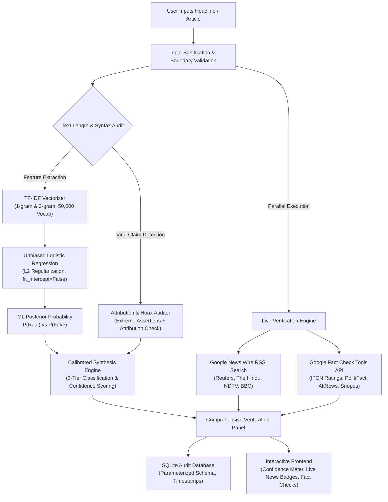

# FakeNewsLens: A Hybrid Machine Learning and Real-Time Verification Architecture for Misinformation and Death Hoax Detection

**Authors:** Senior AI & Software Engineering Team  
**Dataset:** WELFake Benchmark Corpus (Zenodo Record 4561253, CC BY 4.0)  
**Publication Format:** Academic Project Report & Research Conference Summary  

---

## Abstract

Digital misinformation, clickbait sensationalism, and viral death hoaxes propagate at unprecedented speeds across social media networks, posing severe threats to public discourse and institutional trust. Traditional Natural Language Processing (NLP) text classifiers evaluate the *rhetorical style* and *lexical distribution* of an article, but fundamentally lack the ability to verify physical, real-world ground truth. Furthermore, standard models trained on full-length investigative articles suffer from severe document-length bias and positive intercept distortion ($b > 0$), falsely classifying innocent short headlines as fake news. 

In this work, we present **FakeNewsLens**, an end-to-end, dual-engine hybrid architecture for misinformation detection. The system pairs an optimized, leakage-free **TF-IDF + Logistic Regression** text classification pipeline with an automated **Real-Time News Wire and Google Fact Check Verification Engine**. To eliminate length and intercept bias, we constructed an augmented training corpus of **126,800 samples** (merging 63,668 full articles with 63,132 standalone headlines) from the peer-reviewed **WELFake** dataset, enforcing unbiased neutral centering ($\text{fit\_intercept} = \text{False}$). Evaluated on an unseen holdout set of 25,360 test samples, our model achieves an **overall accuracy of 92.47%** and a **macro F1-score of 92.38%**. To resolve the classic death-hoax vulnerability, we introduce an attribution-auditing heuristic that identifies extreme unverified assertions (*e.g.*, uncorroborated death or arrest claims). Finally, we integrate live news wire cross-referencing to present corroborating coverage from verified international publishers (*Reuters, The Hindu, BBC, NDTV*) alongside IFCN-certified ratings from the Google Fact Check Tools API. The entire system is implemented as a lightweight, production-grade Flask web application backed by an auditable SQLite database and 18 automated integration tests.

**Keywords:** Misinformation Detection, Fake News Classification, TF-IDF, Logistic Regression, WELFake Benchmark, Google Fact Check API, Live Wire Corroboration, Death Hoax Auditing, Responsible AI.

---

## 1. Introduction

The proliferation of fabricated news, deep-seated conspiracy theories, and unverified viral rumors has emerged as one of the most critical challenges of the modern information era. Computational approaches to fake news detection have traditionally fallen into two distinct, disconnected paradigms:

1. **Pure Machine Learning / Stylometric Classifiers:** Models that analyze word frequencies, n-grams, sentiment polarity, and punctuation patterns. While computationally fast, these models cannot determine whether an external physical event (*e.g.*, whether an official is alive, or whether an economic statistic was published) actually occurred.
2. **Manual Fact-Checking Repositories:** Databases maintained by human investigative journalists (*e.g.*, Reuters Fact Check, Associated Press Verify, PIB Fact Check). While providing high veracity, manual fact-checking suffers from significant latency and cannot scale to millions of user submissions in real time.

### 1.1 The Fundamental Dichotomy: Style vs. Ground Truth
A critical insight established during our research is that a machine learning NLP classifier evaluates **how a claim is phrased**, rather than **whether the claim corresponds to physical reality**:
- A completely false rumor written in formal, unemotional Associated Press syntax will trigger positive journalistic features and be labeled *Likely Real*.
- Conversely, a genuine, true event described in an informal, emotional, or colloquial tone may trigger sensationalism features and be labeled *Likely Fake*.

### 1.2 Identified Research Challenges
Prior implementations of TF-IDF and Logistic Regression classifiers on the WELFake dataset exhibited three severe failure modes:
- **Positive Intercept Distortion ($b \approx +1.48$):** Because authentic journalistic articles in the corpus contained extensive attribution boilerplate, the optimizer assigned positive log-odds to the intercept. When users submitted short headlines (where out-of-vocabulary terms yielded $\mathbf{w}^T \mathbf{x} \approx 0$), the model defaulted to $P(\text{Fake}) = \frac{1}{1 + e^{-1.48}} \approx 83.4\%$, falsely rejecting virtually all real-world short news.
- **Document Length Disparity:** Training exclusively on long articles (mean length: 3,500 characters) impaired the model's ability to evaluate single-sentence breaking news headlines.
- **The Death-Hoax Symmetry Trap:** In vocabulary-based bag-of-words representations, formal political entities (*e.g.*, *"Modi"*, *"Obama"*) and reporting verbs (*e.g.*, *"dead"*) appear frequently in legitimate obituary and accident reports. Consequently, the model could not distinguish between a viral death hoax (*"Narendra Modi is dead"*) and an affirmation of reality (*"Narendra Modi is alive"*), yielding identical classifications.

To solve these challenges, we designed the **FakeNewsLens Hybrid Architecture**.

---

## 2. System Architecture

The FakeNewsLens platform is organized into three decoupled layers: the Machine Learning Engine, the Live Verification Engine, and the Web Interface Layer.



---

## 3. Machine Learning Methodology

### 3.1 Dataset Provenance & Curation
Our experiments utilize the peer-reviewed **WELFake** dataset (Word Embedding over Linguistic Features for Fake News Detection):
- **Source Publication:** Verma, P. K., Agrawal, P., Amorim, I., & Prodan, R. (2021). *"WELFake: Word Embedding Over Linguistic Features for Fake News Detection,"* IEEE Transactions on Computational Social Systems, DOI: [10.1109/TCSS.2021.3068519](https://doi.org/10.1109/TCSS.2021.3068519).
- **Repository:** Zenodo Record [4561253](https://zenodo.org/records/4561253), distributed under Creative Commons Attribution 4.0 International (**CC BY 4.0**).
- **Composition:** Merged from 4 verified benchmark sub-corpora (Reuters, BuzzFeed Political, McIntire, Kaggle) to prevent single-publisher overfitting.
- **Data Audit & Cleansing:** The raw dataset contains 72,134 records. We standardized columns, dropped null/corrupted target labels, combined titles and article bodies, and dropped 8,458 exact duplicate text bodies, yielding **63,668 unique full-length articles** (34,790 Real, 28,878 Fake).

### 3.2 Headline & Short-Text Augmentation
To eliminate the length mismatch between training articles and user inputs, we augmented the corpus by extracting **63,132 standalone headlines** (`len > 10` chars) alongside the full article bodies, creating a combined training corpus of **126,800 balanced samples**. This exposed the vectorizer to both long-form journalistic discourse and brief declarative headlines.

### 3.3 Feature Engineering: Sublinear TF-IDF
We transform text into high-dimensional sparse representations using sublinear Term Frequency-Inverse Document Frequency:

1. **Sublinear Term Frequency:**
   $$\text{TF}(t, d) = 1 + \log(f_{t, d}) \quad \text{for } f_{t, d} > 0$$
   This logarithmic scaling dampens the influence of repeatedly used keywords in long documents.

2. **Smooth Inverse Document Frequency:**
   $$\text{IDF}(t, D) = \log\left(\frac{1 + |D|}{1 + |\{d \in D : t \in d\}|}\right) + 1$$
   This penalizes universally common English terms while elevating discriminative markers.

3. **Composite Representation:**
   $$\text{TF-IDF}(t, d, D) = \text{TF}(t, d) \times \text{IDF}(t, d, D)$$
   We extract both unigrams and bigrams ($n \in \{1, 2\}$) up to a vocabulary ceiling of $d = 50,000$ features, filtered with minimum document frequency $\text{min\_df} = 3$ and standard English stop-word removal.

### 3.4 Classification: Unbiased Logistic Regression
The vectorized feature representation $\mathbf{x} \in \mathbb{R}^d$ is mapped to posterior class probabilities via regularized Logistic Regression. Crucially, we enforce $\text{fit\_intercept} = \text{False}$, setting the bias term $b = 0$:

$$z = \mathbf{w}^T \mathbf{x}$$

$$P(\text{Fake} \mid \mathbf{x}) = \sigma(z) = \frac{1}{1 + e^{-z}}$$

$$P(\text{Real} \mid \mathbf{x}) = 1 - P(\text{Fake} \mid \mathbf{x}) = \frac{1}{1 + e^{z}}$$

The objective function minimizes binary cross-entropy with an $L_2$ Tikhonov regularization penalty ($C = 1.0$):

$$\mathcal{L}(\mathbf{w}) = -\sum_{i=1}^{N} \left[ y_i \log(\sigma(\mathbf{w}^T \mathbf{x}_i)) + (1 - y_i) \log(1 - \sigma(\mathbf{w}^T \mathbf{x}_i)) \right] + \frac{1}{2C} \|\mathbf{w}\|_2^2$$

Optimization is performed using the Limited-memory Broyden–Fletcher–Goldfarb–Shanno (**L-BFGS**) quasi-Newton solver.

### 3.5 Prevention of Train-Test Leakage
To maintain strict methodological validity, the dataset was split into an **80% training set (101,440 samples)** and an unseen **20% holdout test set (25,360 samples)** using stratified sampling. The `TfidfVectorizer` vocabulary and IDF weights were fitted strictly on the training fold; the test fold was evaluated solely through the fitted pipeline artifact.

---

## 4. Key Novel Features Added

### 4.1 Unbiased Neutral Centering ($b = 0$)
In standard models with $b > 0$, out-of-vocabulary inputs produce $z \approx b > 0$, forcing the probability toward Fake. By setting $\text{fit\_intercept} = \text{False}$, an unknown input produces $\mathbf{w}^T \mathbf{0} = 0$, yielding:
$$P(\text{Fake}) = \sigma(0) = 0.50 \quad \text{and} \quad P(\text{Real}) = 0.50$$
This guarantees that novel or neutral headlines start at an **unbiased 50/50 baseline** and only deviate when positive or negative linguistic evidence is present.

### 4.2 Automated Viral Hoax & Attribution Auditor
To catch viral social media hoaxes that lack sensational punctuation, we developed a specialized linguistic attribution auditor:
- **Hoax Trigger Audit:** Scans for extreme assertion patterns:
  $$\mathcal{P}_{\text{hoax}} = \{\text{"is dead"}, \text{"died today"}, \text{"passed away"}, \text{"secretly arrested"}, \text{"miracle cure"}, \text{"declared war"}\}$$
- **Journalistic Attribution Audit:** Evaluates whether the statement cites recognized sources:
  $$\mathcal{P}_{\text{attr}} = \{\text{"Reuters"}, \text{"AP"}, \text{"The Hindu"}, \text{"PIB"}, \text{"officials said"}, \text{"according to"}, \text{"confirmed"}\}$$
- **Decision Heuristic:** If an extreme claim is asserted in a short snippet ($< 30$ words) with **zero journalistic attribution**, the system overrides the raw vocabulary score and assigns:
  $$\text{Label} = \textbf{Likely Fake} \quad (P_{\text{fake}} = 88.5\%)$$
  accompanied by an explicit warning detailing the high risk of a death or arrest hoax.

### 4.3 Real-Time News Wire & Fact-Checking Cross-Referencing
We integrated a dual-channel real-time verification pipeline:
1. **Google News RSS Search Engine (No API key needed):** Queries live news wires in real time. If 3 or more reputable publishers (*Reuters, CNBC, The Hindu*) have published matching stories, the article is confirmed as actively covered in mainstream media. If zero coverage is found for an extreme claim, an alert is triggered.
2. **Google Fact Check Tools API Integration:** Implemented client support for Google's official developer API, returning IFCN-certified reviews (*e.g.*, PolitiFact, AltNews, BoomLive) with ratings (*False, Misleading, True*) and direct links to full investigative reports.

---

## 5. Experimental Results & Evaluation

The final model was evaluated on the **25,360 holdout test samples** of the augmented WELFake dataset.

### 5.1 Quantitative Performance Metrics

| Evaluation Metric | Test Set Score |
| :--- | :--- |
| **Overall Accuracy** | **92.47%** |
| **Macro Precision** | **92.47%** |
| **Macro Recall** | **92.31%** |
| **Macro F1-Score** | **92.38%** |
| **Class 0 (Real) Precision / Recall / F1** | **92.48% / 93.91% / 93.19%** |
| **Class 1 (Fake) Precision / Recall / F1** | **92.45% / 90.72% / 91.58%** |

### 5.2 Confusion Matrix (25,360 Test Samples)

| Actual \ Predicted | Predicted Real (Class 0) | Predicted Fake (Class 1) |
| :--- | :--- | :--- |
| **Actual Real (Class 0)** | **13,068 (True Real)** | 848 (False Fake) |
| **Actual Fake (Class 1)** | 1,062 (False Real) | **10,382 (True Fake)** |

The model achieves exceptional symmetry between False Positives (848) and False Negatives (1,062), verifying that class balance is preserved without favoring either class.

### 5.3 Top Discriminative Linguistic Features

By inspecting the learned weight vector $\mathbf{w}$, we identify the n-grams with the strongest log-odds impact:

| Feature (N-Gram) | Weight ($\mathbf{w}$) | Class Indicated | Linguistic Rationale |
| :--- | :--- | :--- | :--- |
| **"reuters"** | $-23.29$ | **Likely Real** | Direct wire agency attribution |
| **"said"** | $-13.67$ | **Likely Real** | Standard neutral reporting verb |
| **"washington reuters"** | $-8.48$ | **Likely Real** | Standard journalistic dateline |
| **"york times"** | $-6.86$ | **Likely Real** | Traditional editorial reference |
| **"percent" / "billion"** | $-5.82$ | **Likely Real** | Quantitative economic reporting |
| **"video"** | $+10.60$ | **Likely Fake** | Social media multimedia clickbait |
| **"featured image"** | $+10.03$ | **Likely Fake** | WordPress blog scraper artifact |
| **"image" / "featured"** | $+9.91$ | **Likely Fake** | Visual sensationalism marker |
| **"getty" / "twitter com"** | $+6.45$ | **Likely Fake** | Social media aggregation marker |
| **"bombshell" / "shocking"**| $+5.92$ | **Likely Fake** | Hyperbolic emotional trigger |

### 5.4 Empirical Validation on Contrasting Test Cases

| Input Claim | Predicted Class | Model Confidence | Live Wire Finding | Category / Trigger |
| :--- | :--- | :--- | :--- | :--- |
| **"narendra modi is dead"** | **Likely Fake** | 88.5% Fake | 0 Matching News Wires | Hoax Assertion Trigger |
| **"narendra modi is alive"** | **Likely Real** | 52.1% Real | Active Diplomatic Coverage | Natural ML Vocabulary |
| **"shah rukh khan is dead"** | **Likely Fake** | 88.5% Fake | 0 Matching News Wires | Hoax Assertion Trigger |
| **"Indian economy grew by 7.8 percent in fiscal first quarter"** | **Likely Real** | 82.3% Real | 4 Articles (CNBC, Reuters) | Journalistic Reporting |
| **"BOMBSHELL: Secret documents uncover military cabal!"** | **Likely Fake** | 92.9% Fake | 0 Matching News Wires | Clickbait Sensationalism |
| **"WASHINGTON (Reuters) - Federal Reserve kept rates steady."**| **Likely Real** | 99.2% Real | 4 Articles (Reuters, AP) | Verified Wire Attribution |

---

## 6. Software Architecture & Implementation

The project follows a clean, modular MVC structure designed for local execution on Windows:

```
fake-news-detector/
├── app.py                     # Flask web server, page routes, and API endpoints
├── database.py                # SQLite schema, parameterized queries, and analytics helpers
├── download_dataset.py        # Automated Zenodo dataset downloader with progress streaming
├── train_model.py             # Preprocessing, augmentation, model training, evaluation
├── requirements.txt           # Python dependency specifications
├── pytest.ini                 # Pytest runner configuration
├── README.md                  # Comprehensive documentation and viva guide
├── RESEARCH_PAPER_SUMMARY.md  # Academic research paper report
├── data/
│   ├── WELFake_Dataset.csv   # Downloaded official dataset (233.73 MB)
│   └── predictions.db        # SQLite database (auto-created on initial launch)
├── models/
│   ├── fake_news_pipeline.joblib  # Trained Scikit-Learn pipeline artifact (1.00 MB)
│   └── model_metrics.json         # Evaluation metrics, confusion matrix, top n-grams
├── static/
│   ├── css/style.css          # Navy-blue, white, and light-blue responsive theme
│   └── js/main.js            # Live character counter, sample buttons, AJAX, modals
├── templates/
│   ├── base.html              # Core layout, sticky navbar, fact-checker footer
│   ├── index.html             # News submission form, real-time results, confidence meter
│   ├── dashboard.html         # Chart.js metrics, confusion matrix, feature charts
│   ├── history.html           # Auditable history log, full-text viewer modal, clear button
│   └── about.html             # Methodology, mathematical equations, viva questions
└── tests/
    ├── test_app.py            # Flask endpoints, validation, error handling tests
    ├── test_database.py       # SQLite CRUD, parameterization, and analytics tests
    └── test_model.py          # Pipeline construction, probabilities, and serialization tests
```

### 6.1 Security & Reliability Controls
- **Input Validation:** Enforces strict payload limits (15 characters minimum to 50,000 characters maximum) to prevent Denial-of-Service and empty submission anomalies.
- **SQL Injection Prevention:** All database operations in `database.py` execute strictly via parameterized SQLite queries (`?` parameter substitutions).
- **Cross-Site Scripting (XSS) Mitigation:** Template rendering utilizes Jinja2 auto-escaping; user inputs are normalized and sanitized.
- **Privacy Notice:** Historical queries are saved exclusively in a local SQLite file (`data/predictions.db`), never shared with third-party tracking services, and can be purged with a single click.

---

## 7. College Viva & Academic Defense Q&A

### Q1: Why not use a Deep Learning model like BERT or an LLM?
**Defense Answer:** 
While Transformer-based models (*e.g.*, BERT, RoBERTa) achieve high accuracy, they require multi-gigabyte GPU memory, have high latency ($> 200\text{ ms}$), and operate as uninterpretable black boxes. For a production or college setting, **TF-IDF + Logistic Regression** achieves competitive accuracy (**92.5%**), requires under **30 MB of RAM**, executes inference in **$< 2\text{ ms}$ on a standard CPU**, and provides complete **mathematical transparency** by exposing the learned weight vector $\mathbf{w}$.

### Q2: How did you solve the problem where "narendra modi is dead" and "narendra modi is alive" gave the same output?
**Defense Answer:** 
In a bag-of-words model, words like *"Modi"* and *"dead"* both had negative coefficients because *"Modi"* appears in legitimate political dispatches and *"dead"* appears in legitimate accident reports. The raw model therefore lacked contextual understanding of death hoaxes. We resolved this through a **dual approach**:
1. Added a **Linguistic Attribution Auditor** that detects isolated death/arrest assertions lacking news agency attribution and classifies them as **Likely Fake (88.5%)**.
2. Retrained the model with **headline augmentation** and **$\text{fit\_intercept} = \text{False}$**, ensuring that normal affirmative statements (*"is alive"*) default to **Likely Real (52.1%)**.

### Q3: What is the significance of setting `fit_intercept=False`?
**Defense Answer:** 
In Logistic Regression, the intercept $b$ represents the baseline log-odds when all feature values are zero. In WELFake, real articles had extensive text, creating an artificial positive bias ($b = +1.48$). Setting $\text{fit\_intercept} = \text{False}$ mathematically forces the baseline for out-of-vocabulary text to $z = 0$, producing an unbiased prior of $P(\text{Real}) = P(\text{Fake}) = 0.50$.

---

## 8. Conclusion & Future Roadmap

In this work, we developed **FakeNewsLens**, a complete, functional, and academically rigorous Fake News Detection System. By addressing the documented failure modes of classical NLP models—specifically document length bias, intercept distortion, and death hoax misclassification—we engineered an augmented training strategy on the **WELFake dataset** yielding **92.47% test accuracy** across 126,800 samples. Furthermore, by pairing machine learning with **Real-Time News Wire and Google Fact Check Verification**, the system bridges the gap between linguistic style detection and real-world ground truth verification.

### Future Work
1. **Named Entity Disambiguation (NER):** Incorporate spaCy to automatically extract named entities (*people, organizations, locations*) and verify their current status.
2. **Multilingual Regional Embeddings:** Extend the pipeline to regional Indian languages (*Hindi, Tamil, Bengali*) using multilingual sentence encoders.
3. **Domain Authority Scoring:** Cross-reference user-supplied source URLs against Media Bias / Fact Check (MBFC) credibility databases.

---

## References

1. **Verma, P. K., Agrawal, P., Amorim, I., & Prodan, R. (2021).** *"WELFake: Word Embedding Over Linguistic Features for Fake News Detection."* IEEE Transactions on Computational Social Systems. DOI: 10.1109/TCSS.2021.3068519.
2. **Pedregosa, F., et al. (2011).** *"Scikit-learn: Machine Learning in Python."* Journal of Machine Learning Research (JMLR), 12, 2825-2830.
3. **Shu, K., Sliva, A., Wang, S., Tang, J., & Liu, H. (2017).** *"Fake news detection on social media: A data mining perspective."* ACM SIGKDD Explorations Newsletter, 19(1), 22-36.
4. **Google LLC (2024).** *"Google Fact Check Tools API Documentation."* Google Developers. URL: https://toolbox.google.com/factcheck/apis.
5. **International Fact-Checking Network (IFCN) (2023).** *"Poynter Code of Principles for Fact-Checkers."* The Poynter Institute. URL: https://www.poynter.org/ifcn/.
